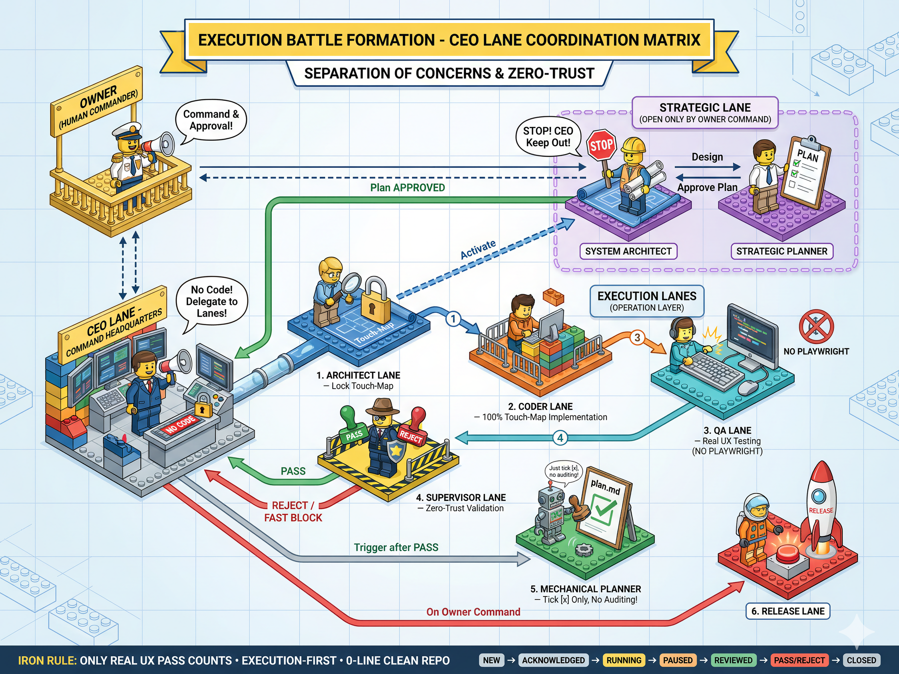

# CEO Plugin (Tài liệu Tiếng Việt)

> **Quy trình Điều phối Đa Tác nhân AI — Cài đặt 1-Click MSI trên Windows & 1 Dòng Lệnh trên macOS / Linux, Tự động Kết nối, Sử dụng Tức thì.**  
> **Version:** <!-- ceo-plugin:version:start -->`2.1.0`<!-- ceo-plugin:version:end -->  
> **Ngôn ngữ:** [English](README_EN.md) | **Tiếng Việt**

---

## CEO Plugin là gì?

**CEO Plugin** là công cụ và quy trình biến các trợ lý AI trong trình soạn thảo mã nguồn của bạn (Antigravity, Cursor, Codex, Claude Desktop, Claude Code CLI) thành một **Hệ thống Điều phối Tự hành Thông minh**.

Thay vì phải nhắc nhở thủ công, giao việc từng bước hoặc giải thích lại ngữ cảnh nhiều lần, CEO Plugin tự động phân công đúng vai trò chuyên môn cho từng tác nhân AI (từ lập kế hoạch chiến lược, thiết kế kiến trúc, lập trình cho đến kiểm thử thực tế và nghiệm thu chất lượng Zero-Trust).




---

## Bước 1: Cài đặt

### Windows (1-Click với bộ cài `.msi`)
Tải xuống bộ cài đặt chuẩn Windows <!-- ceo-plugin:msi:start -->`ceo-plugin-setup-2.1.0.msi`<!-- ceo-plugin:msi:end --> và nhấp đúp chuột để chạy.
- Tự động cài đặt theo phạm vi người dùng (`%USERPROFILE%\.ceo-plugin\bin\ceo-plugin.exe`, không yêu cầu quyền Quản trị viên UAC).
- Tự động thêm vào `PATH` và cấu hình kết nối MCP cho toàn bộ các trình soạn thảo AI bạn đang dùng (Antigravity, Cursor, Codex, Claude Desktop, và Claude Code CLI khi phát hiện trên máy).
- Tự động xuất bộ tài liệu PDF Hướng dẫn Sử dụng chuẩn và Sơ đồ Kiến trúc vào `%USERPROFILE%\.ceo-plugin\Guide\Guide_VN.pdf`, `Guide_EN.pdf` & `CEO-mermaid-diagram.svg` kèm **3 Shortcut trực tiếp trên màn hình Desktop**:
  - **`CEO Plugin - Hướng dẫn (VN)`**
  - **`CEO Plugin - Guide (EN)`**
  - **`CEO Plugin - Architecture Diagram`**

### macOS & Linux (Cài đặt 1 dòng lệnh)
Hỗ trợ **macOS (`darwin/arm64`, `darwin/amd64`)** và **Linux (`linux/amd64`, `linux/arm64`)**:

```sh
curl -fsSL https://raw.githubusercontent.com/tamnguyendinh/CheapApp-Dev-Tool-releases/main/install.sh | sh
```

- Tự động nhận diện hệ điều hành và kiến trúc CPU (bao gồm Apple Silicon chạy qua Rosetta 2), đối chiếu SHA-256 từ `checksums.txt`, và cài đặt theo phạm vi người dùng vào `~/.ceo-plugin/bin/ceo-plugin` (không cần quyền `sudo`).
- Tự động cấu hình `PATH` trong shell (`~/.zshrc`, `~/.bashrc`, `~/.profile`) và kết nối MCP cho các trình soạn thảo AI (Antigravity, Cursor, Codex, Claude Desktop trên macOS, và Claude Code CLI qua `~/.claude.json`).
- Tự động cài bộ tài liệu hướng dẫn và Sơ đồ Kiến trúc vào `~/.ceo-plugin/Guide/` kèm 3 Desktop symlink khi môi trường Desktop khả dụng.
- Tùy chọn ghim phiên bản cụ thể: `curl -fsSL https://raw.githubusercontent.com/tamnguyendinh/CheapApp-Dev-Tool-releases/main/install.sh | CEO_PLUGIN_VERSION=X.Y.Z sh`

---

## Bước 2: Hướng dẫn Sử dụng Chuẩn

### 1. Khởi động lần đầu khi Setup một Repository mới
Khi mở một repository lần đầu tiên sau khi cài đặt, hãy gõ câu lệnh khởi động sau vào khung chat AI:

> `"Tôi bổ nhiệm bạn làm CEO, nạp ceo-plugin MCP lên để có thông tin điều hành."`

Sau khi nhận bổ nhiệm, lúc này repo sẽ được setup mới thông tin về CEO (lúc này `AGENTS.md` và `CLAUDE.md` đã được render đầy đủ thông tin để vận hành CEO Plugin).

### 2. Những lần tiếp theo muốn mở Session CEO
Từ những lần làm việc tiếp theo trên repository đó, khi muốn mở session CEO, bạn chỉ cần gõ câu lệnh:

> `"Tôi bổ nhiệm bạn làm CEO, hãy chuẩn bị sẵn sàng."`

### 3. Quy trình làm việc chuẩn cùng Kiến trúc sư (Quan trọng)

- **Bước 1 — Mở lane Kiến trúc sư & Giữ CEO Standby tuyệt đối:**
  - Khi muốn làm việc, hãy bảo CEO:
    > `"Mở lane kiến trúc sư để tôi thảo luận."`
  - **Lưu ý quan trọng về chống nhiễu Context:** Trong lúc thảo luận với Kiến trúc sư thì hãy yêu cầu CEO **standby tuyệt đối**, cho dù system có nhắn tin thì CEO vẫn phải **im lặng tuyệt đối** để tránh nhiễu context.

- **Bước 2 — Yêu cầu viết Báo cáo Đặc tả (hoặc SPEC):**
  - Khi trao đổi và thống nhất xong hết toàn bộ vấn đề, bạn **Phải** yêu cầu Kiến trúc sư:
    > `"Viết báo cáo đặc tả chi tiết"` *(hoặc `"Viết SPEC"` nếu muốn viết SPEC)*

- **Bước 3 — Rà soát đối chiếu Codebase (Lần 1):**
  - Sau khi có báo cáo (hoặc SPEC), hãy yêu cầu Kiến trúc sư:
    > `"Đọc lại codebase, kiểm tra xem báo cáo có chỗ nào viết nhầm kiến trúc đã thảo luận khiến coder code nhầm không?"`

- **Bước 4 — Rà soát đối chiếu Codebase (Lần 2 & Lặp lại cho đến khi hết điểm lệch — Quan trọng):**
  - Hãy yêu cầu Kiến trúc sư **thêm 1 lần nữa**:
    > `"Đọc lại codebase, kiểm tra xem báo cáo có chỗ nào viết nhầm kiến trúc đã thảo luận khiến coder code nhầm không?"`
  - **Quan trọng:** Cần rà soát thêm để đảm bảo báo cáo (hoặc SPEC) không còn điểm lệch. **Lặp lại cho đến khi không còn điểm lệch.**

- **Bước 5 — Chuyển giao Triển khai:**
  - Tiếp theo, hãy yêu cầu Kiến trúc sư gửi CEO và cho triển khai theo lane thi công (ví dụ: `"Gửi CEO, yêu cầu gọi coder triển khai"`).
  - *(Hoặc bạn tự copy link của báo cáo và yêu cầu trực tiếp CEO mở luồng thi công để triển khai).*

---

## Bước 3: Tham khảo các Vai trò Chuyên môn (Specialist Lanes)

| Khi bạn muốn... | Lệnh CLI / MCP | Trải nghiệm nhận được |
| :--- | :--- | :--- |
| **Điều phối Tổng thể** | `ceo-plugin ceo` | Quản lý phiên làm việc, điều phối các subagent chuyên môn và kiểm soát bàn giao giữa các lane. |
| **Lập Kế hoạch Tổng thể** | `ceo-plugin strategic-planner` | AI tự động chia nhỏ công việc thành các bước nguyên tử, kèm chỉ số đo lường (benchmark) và sổ cái đối chiếu thực tế mã nguồn qua từng giai đoạn. |
| **Thiết kế Kiến trúc & Đặc tả** | `ceo-plugin system-architect` | AI thảo luận cùng bạn để chốt phương án kỹ thuật tối ưu (Mode 0) và xuất báo cáo đặc tả kỹ thuật chi tiết (Mode 1A/1B). |
| **Thi công Mã nguồn** | `ceo-plugin coder` | AI tập trung 100% vào việc viết code chính xác, nguyên tử và tuân thủ chặt chẽ phạm vi Touch-Map được giao. |
| **Kiểm thử Thực tế (Runtime QA)** | `ceo-plugin qa` | AI chạy ứng dụng thực tế sau khi build để kiểm tra hành vi người dùng, dữ liệu đầu-cuối và tương tác giao diện. |
| **Nghiệm thu & Kiểm toán (Zero-Trust)** | `ceo-plugin supervisor` | Độc lập kiểm tra mã nguồn, git diff và bằng chứng thực thi để đảm bảo không còn bất kỳ lỗi tiềm ẩn nào. |
| **Phát hành Phiên bản (Release)** | `ceo-plugin release` | 1 lane duy nhất kiểm tra thay đổi của repo để cập nhật `change.md`, bump version, build gói cài đặt + SHA-256, `-DryRun`, push source sạch và xuất bản release. |

---

## Cập nhật (`ceo-plugin update`)
CEO Plugin tự động kiểm tra phiên bản mới ở chế độ nền, xác thực mã băm SHA-256 và thông báo khi bản cập nhật sẵn sàng (hộp thoại native trên Windows/macOS/Linux Desktop, hoặc thông báo CLI trên môi trường headless).

Bạn cũng có thể kiểm tra hoặc cập nhật thủ công trên **Windows, macOS và Linux**:
- Chỉ kiểm tra phiên bản mới (không ghi đĩa): `ceo-plugin update --check`
- Tải xuống, xác thực SHA-256 và cập nhật ngay: `ceo-plugin update` *(thêm `--yes` khi chạy không tương tác / headless)*

---

## Gỡ cài đặt Sạch sẽ (100% Không để lại Rác)
Khi không còn nhu cầu sử dụng:
- **Windows:** Mở **Windows Settings > Apps > Installed apps**, tìm **CEO Plugin** và nhấn **Uninstall**.
- **macOS & Linux:** Đóng các kết nối MCP đang chạy trong IDE rồi chạy lệnh:
  ```sh
  ceo-plugin uninstall
  ```

Toàn bộ file nhị phân, thư mục `Guide`, 3 Shortcut/symlink trên màn hình Desktop, biến môi trường `PATH` và cấu hình MCP trong các IDE sẽ được gỡ bỏ hoàn toàn, trả lại trạng thái nguyên vẹn cho máy tính của bạn.
